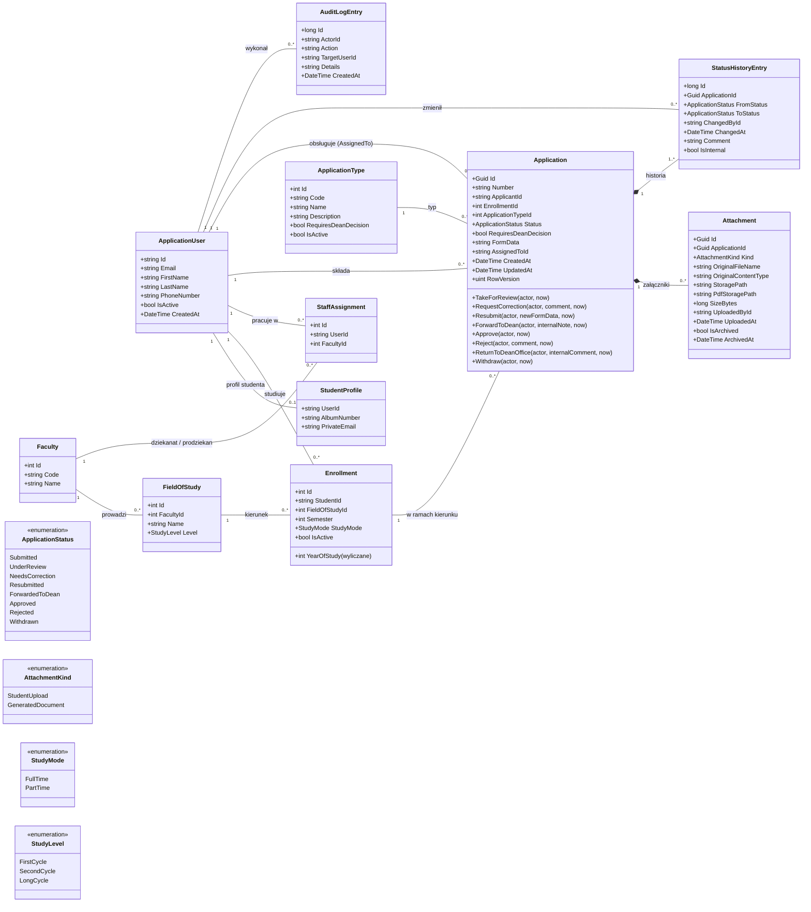
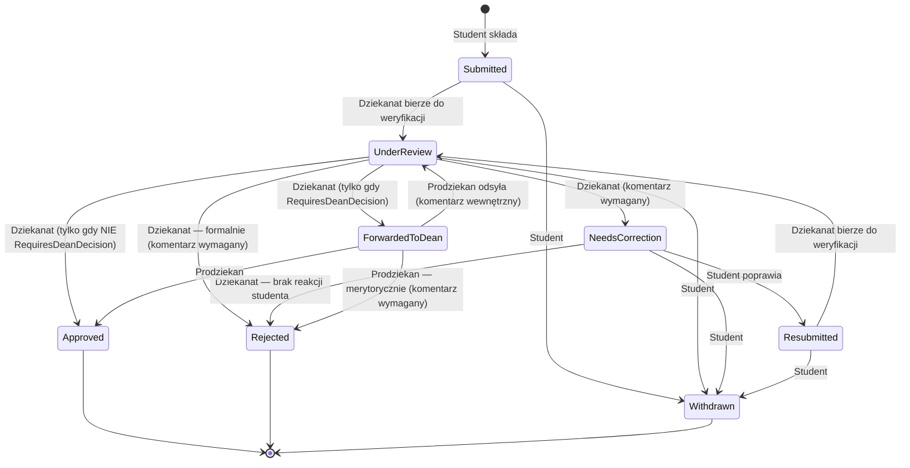

# Model domeny — UniFlow

## Diagram klas

## Wydziały, kierunki i zakres uprawnień

- **Faculty** = jednostka z własnym dziekanatem i prodziekanem. Jeśli na uczelni każdy
  kierunek ma osobny dziekanat, wydział po prostu ma jeden kierunek — model działa tak samo.
- **Enrollment** = konkretne studiowanie kierunku przez studenta (semestr, forma). Student
  na dwóch kierunkach ma dwa `Enrollment`.
- **Każdy wniosek dotyczy jednego `Enrollment`.** Student w kreatorze wybiera kierunek;
  wniosek trafia automatycznie do dziekanatu wydziału:
  `Application → Enrollment → FieldOfStudy → Faculty`.
- **StaffAssignment** przypisuje pracownika dziekanatu / prodziekana do wydziału (jedna osoba
  może mieć kilka przypisań).
- **Rola (Identity) mówi *co* można robić, przypisanie — *gdzie*.** Pracownik dziekanatu
  widzi i zmienia tylko wnioski swoich wydziałów; prodziekan decyduje tylko o wnioskach
  swojego wydziału (resource-based authorization). Admin i Student nie mają przypisań.
- Przypisania nadaje Administrator; każda zmiana trafia do `AuditLogEntry`.
- `Enrollment.YearOfStudy` nie jest kolumną w bazie — wyliczane: `(Semester + 1) / 2`.

## Diagram stanów wniosku

### Tabela przejść (źródło prawdy dla maszyny stanów i testów)

Każde przejście wykonywane przez Dziekanat / Prodziekana wymaga dodatkowo, by użytkownik
miał `StaffAssignment` do wydziału, którego dotyczy wniosek (sprawdza Api), oraz by nie był
autorem wniosku (konflikt interesów — sprawdza Domain).

| Z | Do | Kto | Metoda `Application` | Warunek / uwagi |
|---|---|---|---|---|
| — | Submitted | Student | konstruktor | Złożenie wniosku w ramach własnego, aktywnego `Enrollment` |
| Submitted, Resubmitted | UnderReview | Dziekanat | `TakeForReview` | Ustawia `AssignedTo` |
| UnderReview | NeedsCorrection | Dziekanat | `RequestCorrection` | Komentarz wymagany (widoczny dla studenta) |
| NeedsCorrection | Resubmitted | Student | `Resubmit` | Poprawiony wniosek (nowy `FormData`), priorytet w kolejce |
| UnderReview | ForwardedToDean | Dziekanat | `ForwardToDean` | Tylko gdy `RequiresDeanDecision = true`; opcjonalna notatka wewnętrzna |
| UnderReview | Approved | Dziekanat | `Approve` | Tylko gdy `RequiresDeanDecision = false` |
| UnderReview | Rejected | Dziekanat | `Reject` | Odrzucenie formalne; komentarz wymagany |
| NeedsCorrection | Rejected | Dziekanat | `Reject` | Brak reakcji studenta; komentarz wymagany |
| ForwardedToDean | Approved | Prodziekan | `Approve` | |
| ForwardedToDean | Rejected | Prodziekan | `Reject` | Odrzucenie merytoryczne; komentarz wymagany |
| ForwardedToDean | UnderReview | Prodziekan | `ReturnToDeanOffice` | Komentarz wewnętrzny wymagany (`IsInternal = true`) |
| Submitted, UnderReview, NeedsCorrection, Resubmitted | Withdrawn | Student | `Withdraw` | Tylko autor wniosku; zablokowane od ForwardedToDean |

Rodzaj odrzucenia (formalne / merytoryczne) wynika z historii: kto odrzucił i z jakiego
statusu — nie potrzeba osobnego pola.

## Typy podań w MVP

| Code | Nazwa | Pola formularza (`FormData`) | Załącznik | `RequiresDeanDecision` |
|---|---|---|---|---|
| `PERSONAL_DATA_CHANGE` | Zmiana danych osobowych | nowe imię, nowe nazwisko, uzasadnienie | wymagany (np. akt małżeństwa) | `false` |
| `GROUP_CHANGE` | Zmiana grupy zajęciowej | nazwa przedmiotu, obecna grupa, oczekiwana grupa, uzasadnienie | opcjonalny (np. zaświadczenie od pracodawcy) | `true` |
| `DEAN_LEAVE` | Urlop dziekański | typ urlopu (zdrowotny / okolicznościowy / wychowawczy), okres od–do (semestr / rok akad.), uzasadnienie | wymagany tylko dla urlopu zdrowotnego | `true` |

Reguły „czy załącznik jest wymagany” zależą od wartości pól (urlop zdrowotny), więc są w
walidatorze formularza danego typu (wybieranym po `Code`), a nie w kolumnie bazy.

### Dane identyfikacyjne vs kontaktowe

| Dane | Zmiana | Pole |
|---|---|---|
| Imię, nazwisko | wniosek `PERSONAL_DATA_CHANGE` + dokument → dziekanat | `ApplicationUser.FirstName/LastName` |
| Telefon (opcjonalny) | student sam w profilu, bez akceptacji | `ApplicationUser.PhoneNumber` (wbudowane w Identity) |
| Prywatny e-mail (opcjonalny) | student sam w profilu, bez akceptacji | `StudentProfile.PrivateEmail` |
| E-mail logowania | tylko Administrator | `ApplicationUser.Email` |

Danych kontaktowych nie da się zweryfikować dokumentem, więc nie przechodzą przez workflow;
każda zmiana zapisywana w `AuditLogEntry` (stara → nowa wartość). Adres nie jest zbierany
(minimalizacja danych — decyzje doręczane elektronicznie).

### Efekt zatwierdzenia `PERSONAL_DATA_CHANGE`

- Po przejściu do `Approved` system **automatycznie** aktualizuje `FirstName` / `LastName`
  w `ApplicationUser` (w tej samej transakcji co zmiana statusu).
- Stare wartości zostają w historii: wpis w `AuditLogEntry` (stare → nowe) + dane wniosku.
- Wcześniej wygenerowane PDF-y zostają bez zmian (dokument odzwierciedla stan z chwili
  wygenerowania).
- Dane osobowe dotyczą osoby, nie kierunku — zmiana obowiązuje we wszystkich `Enrollment`.
- **Poza zakresem:** synchronizacja z USOS. W realnym wdrożeniu w tym miejscu system
  wysyłałby żądanie zmiany danych do USOS (punkt integracji — „Kierunki rozwoju”).

## Uzasadnienia kluczowych pól

| Pole | Dlaczego |
|---|---|
| `Application.Id` jako `Guid` | Nie da się zgadnąć cudzego wniosku w URL (`/applications/5` → `/applications/6`). |
| `Application.Number` | Czytelny numer dla ludzi i na PDF, np. `UF/2026/0001`. |
| `Application.EnrollmentId` | Wniosek dotyczy konkretnego kierunku → wyznacza właściwy dziekanat. |
| `Application.FormData` (`jsonb`) | Każdy typ podania ma inne pola — nowy typ bez migracji schematu. |
| `Application.AssignedToId` | Który pracownik dziekanatu prowadzi wniosek — dwie osoby nie robią tego samego. |
| `Application.RowVersion` (`xmin`) | Optymistyczna współbieżność: dwie osoby zmieniające status naraz → druga dostaje błąd zamiast nadpisać decyzję pierwszej. |
| `ApplicationType.Code` | Stały identyfikator techniczny — wybór formularza, walidatora i szablonu PDF. `Name` może się zmienić. |
| `ApplicationType.RequiresDeanDecision` | Krótka ścieżka (decyzja dziekanatu) vs długa (decyzja prodziekana) — jedna maszyna stanów parametryzowana typem. |
| `Application.RequiresDeanDecision` | Kopia flagi z typu w chwili złożenia — wnioski w toku kończą ścieżką z regulaminu, według którego je złożono („prawo nie działa wstecz”). Maszyna stanów sprawdza tę kopię, nie typ. |
| `ApplicationUser.IsActive` | Dezaktywacja zamiast usuwania — historia i audyt muszą wskazywać na istniejących użytkowników. |
| `ApplicationUser.FirstName/LastName` | W `User`, nie w `StudentProfile` — pracownicy też mają imię i nazwisko. |
| `StudentProfile.AlbumNumber` | Jeden numer albumu na studenta na uczelni (niezależnie od liczby kierunków). |
| `Enrollment` | Semestr i forma studiów są per kierunek — student może być na różnych semestrach dwóch kierunków. Dane do nagłówka PDF. |
| `Enrollment.IsActive` | Ukończony / przerwany kierunek zostaje w historii, ale nie można już na nim składać wniosków. |
| `StaffAssignment` | Zakres uprawnień pracownika — tylko wnioski jego wydziałów. |
| `StatusHistoryEntry` | Audit trail: kto, kiedy, z jakiego na jaki status, dlaczego. Tylko dopisywanie, nigdy edycja/usuwanie. |
| `StatusHistoryEntry.IsInternal` | Komentarze wewnętrzne (prodziekan ↔ dziekanat, notatka o wolnych miejscach) ukryte w timeline studenta. |
| `Attachment.Kind` | Rozróżnia pliki studenta od wygenerowanego oficjalnego PDF wniosku. |
| `Attachment.OriginalContentType` | Typ MIME — czy konwertować przez Gotenberg, jak zwrócić plik przeglądarce. |
| `Attachment.StoragePath` + `PdfStoragePath` | Ścieżki na **dysku** (nie w bazie) — oryginał zostaje jako dowód, obok wersja PDF. |
| `Attachment.IsArchived` | Wymóg MVP: archiwizacja zamiast kasowania. |
| `AuditLogEntry` | Zdarzenia spoza obiegu wniosków (nadanie roli, przypisanie do wydziału, dezaktywacja konta, zmiana danych osobowych i kontaktowych). |

